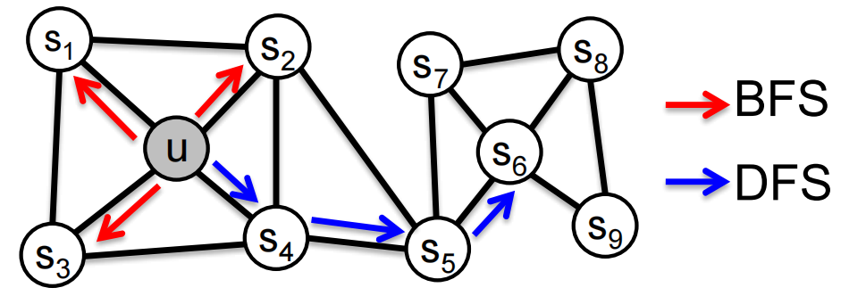
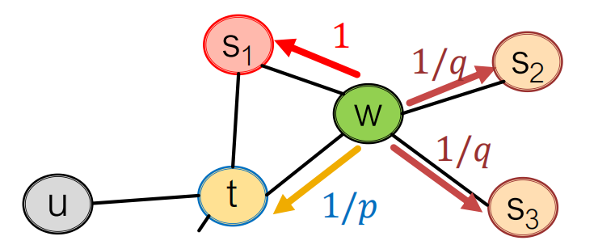
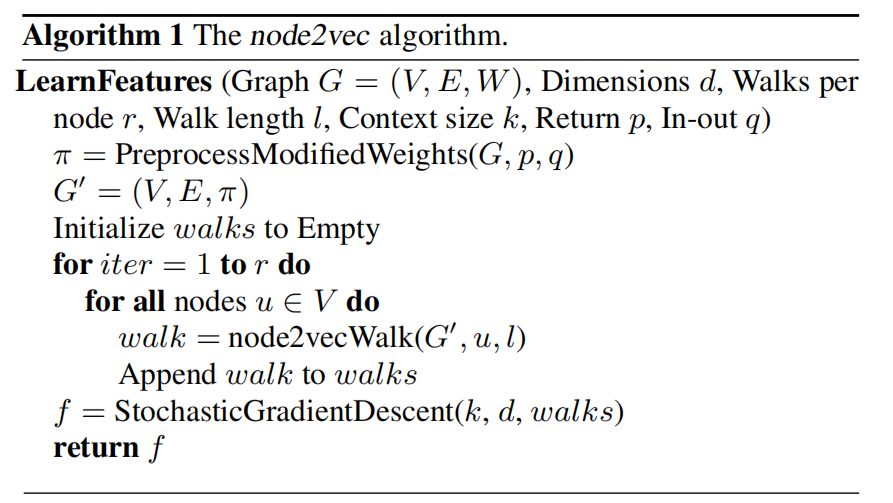
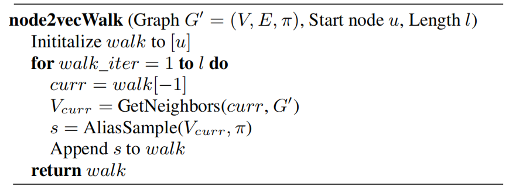

<!-- _class: lead -->

# Node2vec

2026.5

---

<!-- _header: 目录 -->

1.  Overview
2.  Description
3.  Implementation
4.  Other Ideas
---

<!-- _header: 1. Overview -->

Node2vec 发表于KDD 2016$^1$，作者：Stanford University 的 Aditya Grover 教授和 Jure Leskovec 教授.

$\quad$

Node2vec 是图神经网络 (GNN) 中的节点表示学习算法.

核心思想：将图中的每个节点映射到一个低维连续向量空间，使得图中结构相似的节点在向量空间中距离也相近.

> ¹ 论文arxiv地址：https://arxiv.org/abs/1607.00653

---

<!-- _header: Motivation-->

日常生活中，如知识图谱、交通道路联通情况、人际关系等都可以抽象成图结构的数据（node-edge $\rightarrow$ entity-relationship）.

图结构数据具备以下两种结构特性：

* Homophily：相互连接、属于同一社区的节点应该有相似的 embedding（如同一个科研圈）;

* Structural Equivalence：在图中扮演相同角色的节点应该相似（如不同社区的 hub 节点），即使它们相距很远.

但是并没有一种固定的游走策略能同时较好地捕捉这两种特性.

---

<!-- _header: Previous Studies-->

DeepWalk$^1$：将 NLP 中的 Word2Vec 思想迁移到图上，把随机游走生成的节点序列类比为句子，把节点类比为单词，然后用 Skip-gram 模型学习节点 embedding.

虽然采取了随机游走方法，但游走策略概率均等且固定，无法同时捕捉两种不同的图结构特性.

LINE$^2$: 不依赖随机游走，而是直接显式地建模两种节点相似性，分别优化一阶相似性与二阶相似性，拼接成最终的embedding. 

这样的缺陷很明显：对sparse graph的监督不足；无法灵活选择游走策略.

> $^1$ KDD 2014, arxiv地址：https://arxiv.org/abs/1403.6652
> $^2$ WWW 2015, arxiv地址：https://arxiv.org/abs/1503.03578

---

<!-- _header: Node2vec Core Insight-->

$\quad$

$\quad$

用**带记忆的有偏二阶随机游走**，控制游走策略在DFS和BFS之间的倾向性，同时解决"游走无方向性"和"结构特性不可控"两个问题.

---

<!-- _header: 2. Description-->

node2vec核心目标：将具有相似 network neighborhood 的node关系转换成feature space上也接近的关系. 

我们将这个目标转化成最大似然目标优化问题 (maximum likelihood optimization problem)，并且不直接针对特定任务训练，而是先做一个通用的无监督表示学习任务.

这个通用的无监督表示学习任务大致是：给定一个节点 $u$，希望它的网络邻域节点 $N_R(u)$ 在向量空间中更容易被预测出来.

---

<!-- _header: 2. Description-->

论文作者给出了这样的idea：为了丰富结构上下文，节点$u$的邻居节点$N_R(u)$应当被灵活采用. 

为此，论文引入有偏二阶随机游走 (Biased $2^{nd}$ Order Random Walks) 来选取$N_R(u)$.

---

<!-- _header: Biased Walks-->

我们将DFS视作对整张图的global view，将BFS看成是对整张图的local view.

---

<!-- _header: Biased Walks-->

Biased Walks是BFS和DFS的 Interpolation (插值)：

* 用 Return Parameter $p$ 和 In-out parameter $q$ 来控制，$p$反映了节点下一步返回先前节点的意愿，$q$控制的是随机游走是在局部邻域里转还是往远处探索的意愿.

* Random Walks是由single step构成的sequence，因此只需要对每一步做出分类就行.

---

<!-- _header: One Step of the Biased Walks-->

那么，应该如何设置edge transition probabilities? 下面是论文给出的答案：

设起点为$t$，现在走到了$w$，下一步设为$x$. 我们可以看到，$dist(t,x) \in \{0,1,2\}, x \in \{t, S_1, S_2, S_3\}$.

---

<!-- _header: One Step of the Biased Walks-->

我们令转移概率（规范化以前）

$$\alpha_{pq}(t,x) = \begin{cases} \dfrac1p & (dist(t,x) = 0)\\ 1 & (dist(t,x) = 1) \\ \dfrac1q & (dist(t,x) = 2)\\\end{cases}$$

如果$p$比较小，那么整体来看更像BFS-like walk；如果$q$比较小，那么整体上来看更像DFS-like walk. 

---

<!-- _header: One Step of the Biased Walks-->

选择转移到$S_2, S_3$时$dist(t,x) = 2$，深度较大，此时降低$q$可以让转移概率上升，从而增加遍历深度，因而看起来更像是DFS; 选择转移到$S_1$时$dist(t,x) = 1$，选择折返$dist(t,x) = 0$，深度较小，因而减小$q$，增大转移概率看起来更像是BFS.

---

<!-- _header: Pros in Biased Walks-->

设计 Biased $2^{nd}$ Order Random Walks 的好处：

* Space Complexity: $O(|E|)$;
* Time Complexity: $O(a^2|V|)$，其中$a$是节点平均的度数（由于真实世界中一般是稀疏图，所以$a$不是很大）
* 如果将 random walk length 设置成$l$，我们对$(l-k)$个node 取$k$个sample ($k < l$) ，实际的复杂度是$O(\dfrac{l}{k(l-k)})$.

---

<!-- _header: Application: Edge Prediction-->

得到了各个节点的 Feature Embedding向量之后，我们可以完成一些预测性质的任务，如：**预测两个节点 $(u, v)$ 之间是否存在边**.

此时必须将两个节点的向量组合成一个边的特征向量 $g(u, v)$, 这时会用到描述二元运算符 $\circ$.

组合规则是，对向量中的每一个维度 $i$，应用运算符：

$$g_i(u, v) = f_i(u) \circ f_i(v)$$

--- 

<!-- _header: Operator Definitions (for edge prediction)-->

| 算子        | 符号                 | 含义                                                 |
| ----------- | -------------------- | ---------------------------------------------------- |
| Average     | $\boxplus$           | $[f(u)\boxplus f(v)]_i = \dfrac{f_i(u)+f_i(v)}{2}$   |
| Hadamard    | $\boxdot$            | $[f(u)\boxdot f(v)]_i = f_i(u) * f_i(v)$             |
| Weighted-L1 | $\|\cdot\|_{\bar 1}$ | $\|f(u)\cdot f(v)\|_{\bar 1i} = \lvert f_i(u)-f_i(v)\rvert$   |
| Weighted-L2 | $\|\cdot\|_{\bar 2}$ | $\|f(u)\cdot f(v)\|_{\bar 2i} = \lvert f_i(u)-f_i(v)\rvert^2$ |

这些算子用于刻画两个node的feature embedding之间的关系，从结果来分类，做出"存在/不存在"的二分类预测.

---

<!-- _header: 3. Implementation-->

Pseudo Code：

$\quad$

完整代码实现：[node2vec](https://github.com/aditya-grover/node2vec) $\quad$ [snap: node2vec](https://github.com/snap-stanford/snap/tree/master/examples/node2vec)
